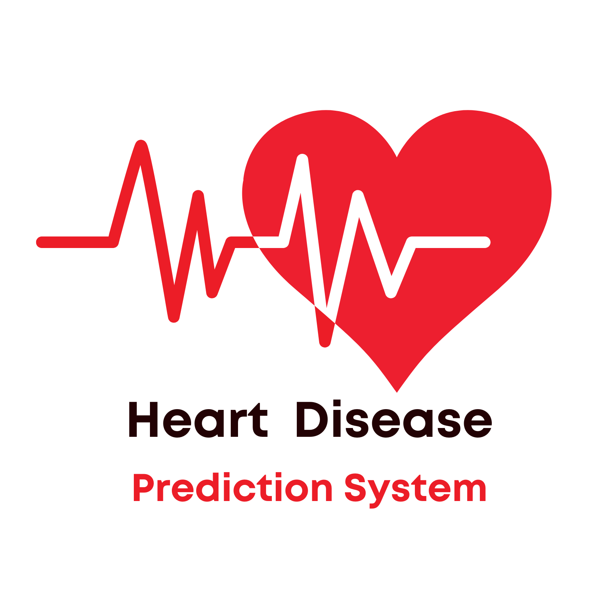

<p align="center">
  
</p>

# Heart Disease Prediction System (HDPS)

A Flutter mobile app that estimates heart disease risk from 13 clinical values. A small neural network, trained in TensorFlow and converted to TensorFlow Lite, runs **on the phone**: no internet connection and no server are needed, and the patient data never leaves the device.


> ### Not a medical device
> This is a student project built to learn machine learning and mobile deployment. It has not been clinically validated and must not be used to make medical decisions. Any result needs to be checked by a doctor.

## What it does

1. The user enters 13 values (age, sex, chest pain type, blood pressure, cholesterol, and so on).
2. The app runs the TFLite model and shows whether the risk looks high or low.
3. The result can be saved as a **PDF report**.

The app also has pages that explain each input value and heart disease in general, and an About page.

## How it is built

| Part | Details |
|---|---|
| Model | Keras `Sequential` network on 13 tabular features, sigmoid output (0 = no disease, 1 = disease) |
| Data preparation | Features scaled with `StandardScaler`, 80/20 train/test split (`random_state=42`) |
| Training | Several experiments in the notebook (plain dense network, with dropout, batch normalization and L2 regularization), Adam optimizer, binary cross-entropy |
| Deployment | Model converted to TensorFlow Lite: `assets/heart_disease_pred.tflite` |
| App | Flutter + `tflite_flutter`; PDF report with `pdf` and `printing` |

## Repository layout

```
lib/                          Flutter app (main.dart, heart_disease_info.dart)
assets/                       TFLite model, logo, images
Juptyer Notebook/             Training notebook (Colab) and the same code as .py
android/ ios/ web/ ...        Flutter platform folders
```

## Run the app

You need the [Flutter SDK](https://docs.flutter.dev/get-started/install) (Dart 3.6 or newer).

```bash
git clone https://github.com/SamiHotak/Heart-Disease-Predicrion-System-using-TF-and-TF-Lite-Mobile-Deployment-.git
cd Heart-Disease-Predicrion-System-using-TF-and-TF-Lite-Mobile-Deployment-
flutter pub get
flutter run
```

The login screen is only a demo screen: use username `admin` and password `admin`. It is a fixed check inside the app, **not real security**, and there are no user accounts.

## Retrain the model

Open the notebook in `Juptyer Notebook/` in Google Colab. It expects a `heart_disease.csv` file with the 13 feature columns and a `target` column (1 = disease, 0 = no disease). The data dictionary is written inside the notebook. After training, convert the Keras model to TFLite and replace `assets/heart_disease_pred.tflite`.

## Limits

- The dataset is small, so results from the model can be wrong, and the numbers shown in the app are not a diagnosis.
- Accuracy figures are not recorded in this repository yet. Run the notebook to get the current numbers for your own data split.
- Input values must be entered in the units the app asks for (for example, cholesterol in mg/dL).

## Author

Sami Hotak, Software Engineering student, Ghalib University, Herat.
